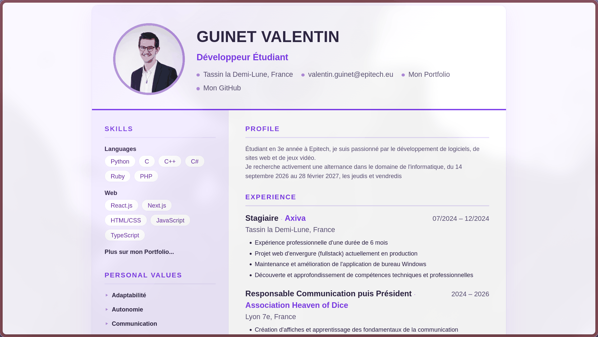
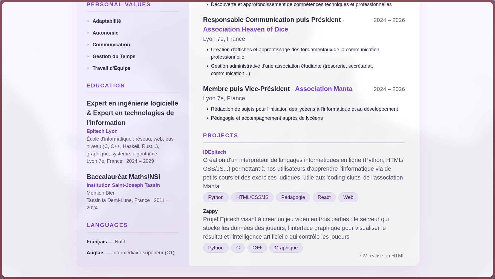

# CV Builder

A single-page, ATS-friendly CV generator. Edit `data.json`, open the page, export to PDF.

## Screenshots





## Requirements

- **Python 3** (or any other static file server)
- A recent browser. Chromium-based browsers (Chrome, Edge, Brave…) give the most faithful PDF export.

## Getting started

1. Create your own data file from the template:

   ```bash
   cp data.example.json data.json
   ```

2. Fill in `data.json`. It is git-ignored, so your personal details (phone, email…) never end up in the repo.

   > [!NOTE]
   > Keep a backup of `data.json` somewhere else: git does not track it. If it is missing, the page falls back to `data.example.json`.

3. Serve the folder and open the page:

   ```bash
   python3 -m http.server 8000
   ```

   Then open http://localhost:8000.

> [!WARNING]
> Opening `index.html` directly (`file://`) does not work: browsers block `fetch()` on local files. Always go through a local server.

## Export to PDF

> [!TIP]
> Press **Ctrl + P** and choose **Save as PDF**. The print stylesheet removes the page shadow, border and margins and outputs exactly one A4 page.

## Files

| File                                   | Role                                                 |
| -------------------------------------- | ---------------------------------------------------- |
| `data.json`                            | your CV content and show/hide toggles (git-ignored)  |
| `data.example.json`                    | fictitious template, used when `data.json` is absent |
| `index.html`, `styles.css`, `script.js` | render the CV from the JSON                          |

## Show / hide anything

Set `"show": false` on any item to hide it — no need to delete it:

- **Whole sections:** `sections.experiences.show`, `sections.projects.show`, `sections.values.show`, `sections.skills.show`, etc.
- **Individual entries:** each experience, project, skill group, value, language, and education item has its own `"show"` flag.
- **Contact fields:** `basics.show` toggles `photo`, `location`, `phone`, `website`, `linkedin`, `github`.

To show your photo: set `basics.photo` to an image path/URL and `basics.show.photo` to `true`.

Optional extras:

- `sections.skills.note`: a line shown under the skill groups (e.g. "More on my portfolio...").
- `final`: a small footer at the bottom right of the page.

## Colors

Set in `meta`: `accentColor` (main purple), `accentColorSoft` (light purple), `backgroundColor` (pastel white). Defaults are a purple-on-pastel-white theme.

## Layout

- **Header** (full width): photo, name, title and contact links.
- **Sidebar** (narrow, purple): Skills, Personal Values, Education, Languages.
- **Main column** (wide): Profile, Experience, Projects.

> [!IMPORTANT]
> The sheet is **locked to a single A4 page** (210×297 mm) on screen and in print, so what you see is exactly the PDF. Content that doesn't fit is **cut off**, not moved to a second page: hide entries or shorten text until everything fits.

## Why it's "good" for humans and robots (ATS)

- Semantic HTML (`<header>`, `<section>`, `<h1>/<h2>`, real `<ul>` lists) so parsers read content in DOM order, with no text trapped in images.
- Contact details are real, selectable text and links (mailto/tel).
- Standard section headings (Experience, Skills, Education…) that ATS expect.
- Selectable text in the PDF (via print, not a screenshot), clean date ranges, and concise, action-oriented bullet points.
