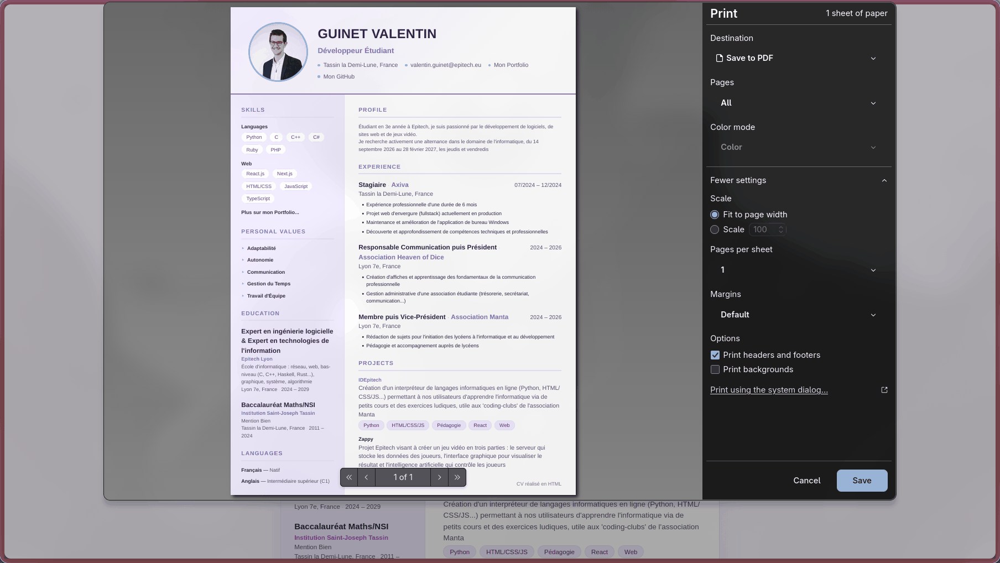

# CV Builder

A single-page, ATS-friendly CV generator. Edit `data.json`, open the page, export to PDF.

## Screenshots




## Requirements

- **Python 3** (or any other static file server)
- A recent browser. Chromium-based browsers (Chrome, Edge, Brave…) give the most faithful PDF export.

## Getting started

1. Create your own data file from the template:

   ```bash
   cp data.example.json data.json
   ```

2. Fill in `data.json`. It is git-ignored, so your personal details (phone, email…) never end up in the repo.

   > [!NOTE]
   > Keep a backup of `data.json` somewhere else: git does not track it. If it is missing, the page falls back to `data.example.json`.

3. Serve the folder and open the page:

   ```bash
   python3 -m http.server 8000
   ```

   Then open http://localhost:8000.

> [!WARNING]
> Opening `index.html` directly (`file://`) does not work: browsers block `fetch()` on local files. Always go through a local server.

## Export to PDF

Click **Download PDF** in the bar above the page (or press **Ctrl + P**) and choose **Save as PDF**. The file name is already filled in from the page title. The print stylesheet hides the bar, removes the page shadow, border and margins and outputs exactly one A4 page.

To export every compo at once (needs Chrome or Chromium):

```bash
./export.sh               # base CV + every compo
./export.sh web edtech    # only these compos ("base" = the CV without compo)
```

PDFs land in `exports/` (git-ignored). Set `CHROME=/path/to/chrome` if the browser is not found.

## Files

| File                                    | Role                                                 |
| --------------------------------------- | ---------------------------------------------------- |
| `data.json`                             | your CV content and show/hide toggles (git-ignored)  |
| `data.example.json`                     | fictitious template, used when `data.json` is absent |
| `index.html`, `styles.css`, `script.js` | render the CV from the JSON                          |
| `export.sh`                             | exports the compos to PDF with headless Chrome       |

## Show / hide anything

Set `"show": false` on any item to hide it — no need to delete it:

- **Whole sections:** `sections.experiences.show`, `sections.projects.show`, `sections.values.show`, `sections.skills.show`, etc.
- **Individual entries:** each experience, project, skill group, value, language, and education item has its own `"show"` flag.
- **Contact fields:** `basics.show` toggles `photo`, `location`, `phone`, `website`, `linkedin`, `github`.

To show your photo: set `basics.photo` to an image path/URL and `basics.show.photo` to `true`. `basics.photoZoom` zooms into the center of the photo (`1` = no zoom, `1.5` = 150%…).

Optional extras:

- `sections.skills.note`: a line shown under the skill groups (e.g. "More on my portfolio...").
- `final`: a small footer at the bottom right of the page.
- `meta.file`: the PDF file name of the base CV (without compo).

## Compos (one CV per target domain)

A compo is a variant of the CV for one kind of job (game dev, web, embedded…). The bar above the page switches between them, and the URL keeps the choice (`?compo=web`), so a link opens the right one.

Add them to the `compos` list in `data.json`. Every field is optional except `id`; anything left out comes from the base CV:

```json
"compos": [
  {
    "id": "web",
    "label": "Web fullstack",
    "file": "CV Jane Doe - Web",
    "meta": { "accentColor": "#0d9488" },
    "basics": { "title": "Student Web Developer", "summary": "..." },
    "highlight": ["React", "Next.js", "TypeScript"],
    "skills": [{ "category": "Front", "items": ["React", "Next.js"] }],
    "experiences": [{ "id": "example-corp", "highlights": ["..."] }],
    "projects": ["playground", { "id": "multiplayer-game", "description": "..." }]
  }
]
```

| Field                                          | Effect                                                                                                                                                                                                 |
| ---------------------------------------------- | ------------------------------------------------------------------------------------------------------------------------------------------------------------------------------------------------------ |
| `label`                                        | name on the button                                                                                                                                                                                     |
| `file`                                         | PDF file name (default: `CV - <name> - <label>`)                                                                                                                                                       |
| `meta`, `basics`, `sections`                   | merged into the base ones: set only what changes (color, title, summary…)                                                                                                                              |
| `highlight`                                    | technologies to put forward: their chips are filled with the accent color and come first in each skill group                                                                                           |
| `projects`, `experiences`, `education`         | list of ids: only these entries are shown, in this order, **even if `"show": false`**. An item can be an object (`{ "id": ..., "description": ... }`) to change some of its fields for this compo only |
| `skills`, `values`, `languages`, anything else | replaces the base value                                                                                                                                                                                |

An entry's id is its `id` field, or else a slug of its `name` / `company` / `school` (`"Example Corp"` → `example-corp`).

> [!TIP]
> Keep every project in `projects` with `"show": false` as a library: the base CV stays short and each compo picks what it needs.

> [!WARNING]
> Compos fill up the page fast. When something is cut off at the bottom, a red warning appears in the bar: drop a project or shorten bullets in that compo.

## Colors

Set `meta.accentColor`: the soft, tint, background, line and text colors are derived from it. `accentColorSoft`, `accentColorTint` and `backgroundColor` override the derived ones if needed. Defaults are a purple-on-pastel-white theme.

## Layout

- **Header** (full width): photo, name, title and contact links.
- **Sidebar** (narrow, purple): Skills, Personal Values, Education, Languages.
- **Main column** (wide): Profile, Experience, Projects.

> [!IMPORTANT]
> The sheet is **locked to a single A4 page** (210×297 mm) on screen and in print, so what you see is exactly the PDF. Content that doesn't fit is **cut off**, not moved to a second page: hide entries or shorten text until everything fits.

## Why it's "good" for humans and robots (ATS)

- Semantic HTML (`<header>`, `<section>`, `<h1>/<h2>`, real `<ul>` lists) so parsers read content in DOM order, with no text trapped in images.
- Contact details are real, selectable text and links (mailto/tel).
- Standard section headings (Experience, Skills, Education…) that ATS expect.
- Selectable text in the PDF (via print, not a screenshot), clean date ranges, and concise, action-oriented bullet points.
